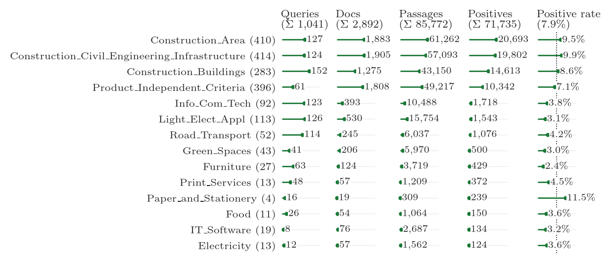

# TENDRIL-Train: LLM-Judged Tender Retrieval Data

Training data for retrieving sustainability-relevant passages from Swiss public procurement tenders. It accompanies
the human-annotated benchmark [IntelliProcure/TENDRIL](https://huggingface.co/datasets/IntelliProcure/TENDRIL).
Queries are the areas of action (Handlungsfelder) and criteria of our sustainability catalogs, which are based on
Swiss and EU recommendations for sustainable public procurement. Each query-passage pair was graded by a large
language model.

## Dataset structure

The configs are in MTEB retrieval format, all with the split `train`:

| Config | Columns | Rows |
|---|---|---|
| `corpus` | `id`, `text`, `project`, `document`, `page` | 85,772 passages |
| `queries` | `id`, `text`, `level`, `catalog`, `area` | 1,041 queries |
| `qrels` (default) | `query-id`, `corpus-id`, `score` | 911,540 judgments |

- **`score`**: 0 = not relevant, 1 = partially relevant, 2 = relevant.
- **`level`**: `area_of_action` (413 queries) or `criterion` (628 queries). For criteria, `area` gives the parent
  area of action.
- **`project` and `document`**: keyed hashes of the SIMAP project number and of the document file name. They let
  you group passages by project or document (631 projects, 2,892 documents) but cannot be reversed. A passage was
  only judged against queries selected for its own project.
- **`page`**: the page of the source document the passage comes from.

| Level | Score 0 | Score 1 | Score 2 |
|---|---|---|---|
| Area of action | 413,877 | 30,631 | 12,141 |
| Criterion | 425,928 | 22,570 | 6,393 |
| Total | 839,805 | 53,201 | 18,534 |

Queries per catalog: Construction_Buildings 152, Construction_Area 127, Light_Elect_Appl 126,
Construction_Civil_Engineering_Infrastructure 124, Info_Com_Tech 123, Road_Transport 114, Furniture 63,
Product_Independent_Criteria 61, Print_Services 48, Green_Spaces 41, Food 26, Paper_and_Stationery 16,
Electricity 12, IT_Software 8.



Each row covers the judgments against one catalog's queries, with the number of projects in parentheses. A project can
be judged against several catalogs, so projects, documents, and passages repeat across rows, and the column headers
give the unique totals. A positive is a judgment with score 1 or 2.

```python
from datasets import load_dataset

corpus = load_dataset("IntelliProcure/TENDRIL-Train", "corpus", split="train")
queries = load_dataset("IntelliProcure/TENDRIL-Train", "queries", split="train")
qrels = load_dataset("IntelliProcure/TENDRIL-Train", "qrels", split="train")
```

## Dataset creation

1. **Project and document selection.** 800 tender projects published on [simap.ch](https://www.simap.ch) were
   sampled, with up to five documents each. Every project gets one criterion per selected area of action. Areas are
   drawn by quota from tiers of prior relevance evidence (validated relevant, unvalidated relevant, unsure,
   irrelevant), plus a coverage top-up so that every area appears in at least three projects. Projects of the
   TENDRIL test set are excluded. The random seed is 42.
2. **Passage filtering.** Passages from the IntelliProcure document pipeline are kept if they have 20–5,000
   characters, are not dominated by digits or symbols, are not degenerate tables, and are not near-duplicates
   (5-gram Jaccard ≥ 0.7).
3. **Anonymization.** Person names, e-mail addresses, phone numbers, URLs, account numbers and credentials are
   replaced by placeholders such as `<PERSON_1>`, using [gheim](https://huggingface.co/joelbarmettler/gheim-ch-560m).
4. **Query wording.** Areas of action use a German summary of at most 100 words, generated from the catalog by
   `deepseek/deepseek-v4-flash` (temperature 0). Criteria use the criterion text followed by its ambition levels
   (Basis, Gute Praxis, Vorbild). The same wording is used in the test set.
5. **Relevance judgments.** Each query-passage pair of a project was graded by `z-ai/glm-5.3-flash` (low reasoning
   effort, temperature 0) via OpenRouter, using the shortest of three versions of the German annotation guidelines,
   in October 2026. Of 906,984 requests, 7 could not be parsed and 47 were truncated.
6. **Restricted documents.** Projects whose tender documents limit their use to the preparation of an offer, or
   prohibit publication or disclosure to third parties, were excluded (169 of the 800 projects).

## Label quality

The judge was selected on a human-annotated calibration set of 1,425 query-passage pairs (three annotators, ten
catalogs), out of eight LLMs at two reasoning efforts and three prompt versions. Agreement between the selected judge
and the curated human labels:

| Level | Cohen's κ (0/1/2) | Cohen's κ (relevant vs. not) |
|---|---|---|
| Area of action | 0.48 | 0.62 |
| Criterion | 0.53 | 0.65 |

For comparison, Krippendorff's α between the three human annotators is 0.57 (area) and 0.59 (criterion). The labels
are noisy and should be treated as weak supervision.

## Limitations

- **Missing test sectors.** No training queries come from the Textiles or Wastepaper_Cleaning_Refuse catalogs, which
  appear in the test set.
- **Skewed labels.** Queries have very different numbers of judgments (median 349, maximum 22,170), and 92% of
  judgments are 0.
- **Imperfect anonymization.** Automatic anonymization can miss entities; please report any personal data you find.

## Access and versions

The dataset is gated: access is granted automatically after accepting the license terms. Passages are removed on
request, for example when a person reports remaining personal data. Each release is marked with a git tag; pin a tag
or commit with `revision=`.

## License

The selection, queries, relevance judgments, anonymization and identifiers (the Licensed Contributions) are
released under the [TENDRIL Open RAIL-D License](LICENSE.md), which permits commercial use but adds use-based
restrictions specific to procurement. Models trained on this data are not Derivatives of the Data under that
license. The tender documents themselves remain the property of their authors; see the license for details.

## Citation

```bibtex
@misc{rolshoven2026tendril,
  title  = {{TENDRIL}: Benchmarking Sustainability-Focused Retrieval in Swiss Public Procurement},
  author = {Rolshoven, Luca and Probst, Sophie and Matoshi, Veton and Ellendorff, Tilia and Meili, Rahel and
            Hostettler, Sarah and Jann, Jeremy Austin and Jans, Meret and Tschumi, Pascal and St{\"u}rmer, Matthias},
  year   = {2026}
}
```
